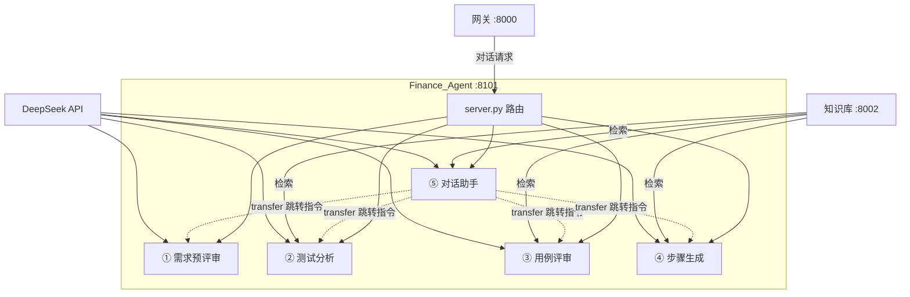

# 智能测试全流程平台 · Finance_Agent

AI 辅助的完整测试链路：**需求落地 → 测试分析 → 用例评审 → 步骤生成**，外加 **⑤ 智能对话助手** 常驻接入。

> 模型：DeepSeek API（`deepseek-v4-flash`），经 `ChatOpenAI` 兼容层接入。原本地 Ollama 方案（8G 内存跑不动）已废弃。
> 承载：单进程（8101）承载 5 个智能体，按 `agent_id` 路由（原多端口架构已废弃）。
> 接口与环境变量细节见 `docs/`，本文件不重复。

---

## 1. 项目是干什么的

面向测试团队的全流程 AI 辅助平台，5 个智能体覆盖：

| 智能体 | 输入 | 输出 | 解决什么问题 |
|--------|------|------|--------------|
| ① 需求预评审 | 需求文本 | 预评审报告 + 审批点 | 需求落地前发现问题 |
| ② 测试分析 | 正式需求 | 六维测试分析报告 | 分析覆盖测试要点 |
| ③ 用例评审 | 测试用例 | 评审报告 + 18 项 ISTQB 打分 | 用例质量把关 |
| ④ 步骤生成 | 用例标题 | 详细测试步骤 | 免手工写步骤 |
| ⑤ 对话助手 | 对话 / 上传 / 转交 | 智能回答 / 转交报告 | 常驻入口，承接前三者 |

## 2. 各模块作用

| 模块 | 作用 |
|------|------|
| `src/api/server.py` | 唯一 HTTP 入口，按 `agent_id` 路由 5 个智能体，SSE 流式输出 |
| `src/agents/agent1~5` | 各智能体实现（LangGraph 图编排 + 节点 + Prompt） |
| `src/config/` | 全局配置与模型配置 |
| `src/models/` | `get_llm()` 模型工厂（遗留，各 agent 目前自行创建 ChatOpenAI，待统一） |
| `src/knowledge/` | 知识库：本地 ChromaDB + 远程 KB REST 客户端 |
| `src/pipeline/` | 全流程编排（CLI 用，串联 agent1→4；Web 走网关编排） |
| `src/port_manager/` | 端口管理器（过时子系统，新开发禁止依赖） |
| `docs/` | 5 份规范文档 + 3 个 KB 知识数据源文件夹 |

## 3. 结构图



> agent1→4 业务链路（预评审→分析→评审→步骤）由**网关/CLI 编排**，agent 间不互调；agent5 转交仅发跳转指令（前端跳转页），不再进程内代跑。

---

## 4. 目录结构

```
Finance_Agent/
├── README.md
├── main.py                          # 统一入口
├── requirements.txt
├── .env.example
│
├── src/                             # 源代码根目录
│   ├── config/                      # 配置层
│   │   ├── settings.py              #   全局配置
│   │   └── models.py                #   LLM 模型配置
│   │
│   ├── models/                      # LLM 模型层
│   │   └── factory.py               #   get_llm() 统一工厂
│   │
│   ├── knowledge/                   # 共享知识库层
│   │   ├── chroma_store.py          #   ChromaDB 本地知识库
│   │   ├── remote_kb.py             #   远程 KB REST API 客户端
│   │   └── builder.py               #   知识库构建 CLI
│   │
│   ├── agents/                      # 5 个智能体（单进程承载，按 agent_id 路由）
│   │   ├── agent1/                  # ① 需求预评审 (7节点线性) — requirement-pre-review
│   │   │   ├── graph/workflow.py    #   LangGraph 线性流水线
│   │   │   ├── state.py             #   RequirementState
│   │   │   ├── prompts.py           #   System Prompt
│   │   │   └── nodes/               #   7 个节点文件
│   │   │
│   │   ├── agent2/                  # ② 需求分析 (5节点, 1条件路由) — ai-test-analysis
│   │   │   ├── core/graph.py        #   LangGraph 条件路由（闲聊/检索）
│   │   │   ├── core/state.py        #   AgentState + InputState
│   │   │   ├── prompts/*.txt
│   │   │   └── handlers/            #   keyword_extractor / retriever / llm_handler
│   │   │
│   │   ├── agent3/                  # ③ 用例评审 (7节点, 三路并行) — accounting-expert
│   │   │   ├── graph/workflow.py
│   │   │   ├── graph/state.py       #   ReviewState
│   │   │   ├── prompts/             #   keyword + review Prompt
│   │   │   └── nodes/               #   5 个节点（keyword_parse 已并入 keyword）
│   │   │
│   │   ├── agent4/                  # ④ 步骤生成 (7节点, 1条件分支) — business-analyst
│   │   │   ├── modules/workflow/graph.py
│   │   │   ├── modules/state/state_def.py  #   WorkflowState
│   │   │   ├── modules/workflow/nodes/     #   5 个节点
│   │   │   └── modules/llm/llm_client.py
│   │   │
│   │   └── agent5/                  # ⑤ 智能对话助手 (意图识别, 4分支) — ai-assistant
│   │       ├── core/graph.py        #   LangGraph 意图路由（chat/kb_query/doc_qa/transfer）
│   │       ├── core/state.py        #   AssistantState（消息/意图/上下文/转交字段）
│   │       └── core/handler.py      #   意图识别 + 三种回答 + 转交
│   │
│   ├── pipeline/                    # 全流程编排层
│   │   └── orchestrator.py          #   FullPipeline 串联主流程 4 个智能体（agent5 走 API）
│   │
│   └── api/                         # API 服务（单进程 8101，按 agent_id 路由）
│       └── server.py                #   FastAPI 统一入口
│
├── docs/                            # 规范文档 + 知识数据源（见 docs/规范与解释/架构与编码规范.md §6）
│   ├── 规范与解释/                  #   5 份规范文档
│   │   ├── 架构与编码规范.md        #     架构图 / 目录 / 分层职责 / 红线 / 文档纪律
│   │   ├── 接口契约总表.md          #     统一事实来源：全部接口 + 四端职责（原接口流程文档已并入）
│   │   ├── 环境变量解释文档.md      #     按数据流解释环境变量
│   │   ├── agent5调度改造方案.md    #     agent5 对话调度方案（已实施）
│   │   └── OCR实现方案.md           #     图片 OCR 契约（给 Gateway 对接方）
│   ├── standard_cases/              #   KB 数据源：标准测试用例
│   ├── history_defects/             #   KB 数据源：历史缺陷模式
│   └── test_specs/                  #   KB 数据源：测试规范（ISTQB 评审 + agents 测试用例）
│
└── tests/
    └── test_api_contract.py         # API 契约测试
```

---

## 5. 启动

```bash
pip install -r requirements.txt
cp .env.example .env        # 填入 DEEPSEEK_API_KEY（必填）
python -m src.api.server    # 监听 8101
```

CLI 直跑（不启服务）：`python main.py pipeline -i "需求文本"` / `python main.py agent -n agent1 -i "需求文本"`。

> 完整联调（含知识库 8002）与 SSE 调用示例见 `docs/规范与解释/接口契约总表.md`。

---

## 6. 更新改动记录

| 日期 | 改动 | 提交 |
|------|------|------|
| 2026-08-21 | **合并对方 4 个提交**：审计报告严重度 1/3/4/6 项修复（X11 报告取值 `messages[-1]`、附件去重 raw_query、KB 空查询兜底、step_no 类型校验）+ agent5 多轮记忆（PostgresSaver）+ 文档 v2（接口契约总表/OCR 方案） | `434d648` 等（本地手工合并） |
| 2026-08-20 | **结构优化 + 耗时压降 + agent5 跳转调度**：agent3 节点 8→7（合并 keyword_parse）；删死字段/死函数（retrieved_documents/retrieval_queries/kb_code_list/keywords/transfer_result/_extract_last_user_query）；agent4 检索串行→并行（asyncio.gather）；agent3 temperature 0.7→0.2 + max_tokens=2048；agent4 max_tokens=1024；agent3 输出瘦身（kb_evidence≤100/issue≤30/suggestion≤30）；agent5 意图升级 6 态（transfer_propose/confirm/cancel）+ resolve_transfer 4 目标映射 + 前端弹窗确认跳转 | 本地（18 文件，备份见 `本地学习/40_项目改动/backup_20260820_结构优化/`） |
| 2026-08-10 | **agent5 多轮记忆实现**：PostgresSaver（AsyncPostgresSaver 惰性挂载）持久化，跨请求+跨重启+多会话隔离；新增 `checkpointer.py`，改 `graph.py`/`server.py`；依赖 +`psycopg[binary]` | `1222d96` |
| 2026-08-10 | **接口契约总表 v2.0**（统一事实来源）：合并接口流程文档（已删）+ 新增 OCR 契约/记忆契约/流程图约定/agent6/7 预留/四端职责；原接口流程文档退役删除 | `1222d96` |
| 2026-08-10 | **OCR 实现方案**（丢给网关）：图片→OCR→文本进 attachments，Agent 只收文本；契约 §5.1 | `1222d96` |
| 2026-08-10 | **agent5 前端业务流程图 MVP**：FlowVisualizer 组件（SSE 事件驱动，节点对齐契约 §6.2），前端+参考扩展 | `1222d96` |
| 2026-08-07 | 智能对话助手前端 UI 本地化：GlobalAssistant / agent5 图片移出主仓库跟踪；完整实现副本放 `参考扩展/`（本目录内，等同路径结构，供他人参考移植） | `3fb55ee`/`671de28` |
| 2026-08-07 | docs 规范化：重构为 4 份文档（测试用例/架构规范/接口流程/环境变量），删除冗余 | `c3f5eda` |
| 2026-08-07 | README 重构：架构图 + 流程图 + 开发计划 | `08ad105` |
| 2026-08-07 | 代码规范：分层职责 + 红线清单；端口文档归档后删除 | `23c9780` 等 |
| 2026-08-07 | 新增 agent5 智能对话助手（4 意图）+ 网关接入（后端能力，前端 UI 见本目录 `参考扩展/`） | `74658fa`~`aeff54b` |
| 2026-08-07 | 修复代理/TUN 劫持：Agent/Gateway/agent5 全部 `trust_env=False` | `7e8de6b`/`2877227` |
| 2026-08-07 | agent3 KB 编码修正（KB04/05/06）+ 合并重构 | `97489b8`/`f5d34d5` |
| 2026-08-07 | 8101 可选鉴权、5 项健壮性修复 | `325dd2f`/`8c2714e` |

---

## 7. 开发计划

### 已上线（当前）

| 项 | 状态 | 说明 |
|----|------|------|
| ①~④ 四大测试智能体 | [OK] | 需求预评审 → 测试分析 → 用例评审 → 步骤生成 |
| ⑤ 智能对话助手（agent5） | [OK] | 意图识别 6 态：chat / kb_query / doc_qa / transfer_propose / transfer_confirm / transfer_cancel（2026-08-20 升级两段确认 + 前端跳转） |
| 前端悬浮助手（GlobalAssistant） | [OK] | SSE 流式对话，4 种心情形象 |
| 悬浮助手文件上传 | [OK] | [附件] 上传（≤10MB，类型白名单）→ doc_qa 文档问答，端到端实测通过 |
| Gateway 接入 agent5 | [OK] | 白名单 / 转发 / 事件透传 |
| 代理劫持修复（trust_env=False） | [OK] | Agent / Gateway / agent5 检索全面覆盖 |

### 近期（下一迭代）

- **agent5 多轮记忆 ✅（2026-08-10 已实现）**：`PostgresSaver` 持久化（PG 建表），跨请求 + 跨重启 + 多会话隔离（thread_id=conversation_id，Gateway 已具备）。契约见 `docs/规范与解释/接口契约总表.md` §8。
- **agent5 对话调度跳转 ✅（2026-08-20 已实现）**：识别转交意图（预评审/六维/用例评审/步骤生成）→ 两段确认（agent5 对话确认 + 前端弹窗）→ 跳转目标 agent 页带原始内容自动发起。方案见 `docs/规范与解释/agent5调度改造方案.md`。
- **上传路由细化**：agent5 上传文档后按内容路由到更具体的 agent（当前仅 doc_qa / transfer 两档）。

### 中期（规划）

- **⑥ 缺陷检测智能体**：检测需求 / 用例中的缺陷（遗漏、矛盾、歧义），复用 agent1 解析与 agent3 清单评审模式。
- **⑦ 精准回归智能体**：按变更点精准筛选回归用例，依赖知识库检索（历史缺陷、标准用例）。
- **全流程编排可视化**：前端展示 5 个 agent 的实时节点进度（progress 事件已具备数据基础）。

### 远期（愿景）

- 测试执行闭环：步骤生成后自动对接执行引擎，回写结果形成知识反哺。
- 多模型可选：DeepSeek / 其他兼容 OpenAI 协议模型按配置切换。

---

## 8. 常见问题

| 问题 | 原因 | 解决 |
|---|---|---|
| 启动报 API Key 不存在 | `.env` 未配置 | 从 `.env.example` 复制填写（见环境变量文档） |
| 调 agent 报知识库不可用 | KB 服务未启动 | 启动知识库(8002)；或开启本地降级（见环境变量文档） |
| 检索结果为空 | KB 数据未重建索引 | 运行 rebuild 脚本 |
| 本机开代理工具（TUN）时连接失败 | 代理接管本地流量 | 已内置 `trust_env=False` 修复；仍异常请关 TUN 或加本地绕过 |
| IDE 中报 `modules` 导入解析不到 | agent4 用扁平导入，静态分析不识别 | 配置 `.vscode/settings.json` 的 `python.analysis.extraPaths`（见下） |

> [警告] **IDE 静态分析配置**：agent4 使用扁平 `modules.` 导入，需要把 4 个 agent 目录加入解析路径（`.vscode/settings.json`）：
> ```json
> {
>   "python.analysis.extraPaths": [
>     "src/agents/agent1", "src/agents/agent2",
>     "src/agents/agent3", "src/agents/agent4", "src/agents/agent5"
>   ]
> }
> ```
