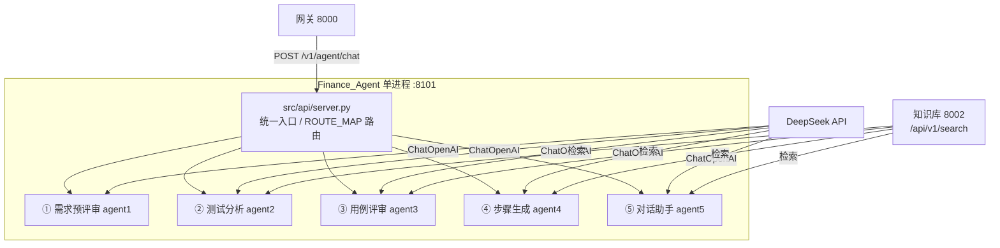

# Finance_Agent 架构与编码规范

> 更新日期：2026-08-07
> 适用范围：`src/` 全层与 `docs/`。
> 目标：单进程承载 5 个智能体，按 `agent_id` 路由；新代码与现有 agent 保持同一套约束，减少维护成本。

---

## 1. 系统架构



**架构决策**：
- 单进程、单端口（8101）：5 个 agent 全部由 `server.py` 的 `ROUTE_MAP` 分发，**不拆多端口**（原多端口架构已废弃）
- agent 间不互调：流程编排由网关(8000)负责，本服务只响应请求（agent5 transfer 例外：识别意图后生成跳转指令，由**前端**跳转目标 agent 页，agent 图内不代跑其他 agent）
- 外部依赖仅两个：DeepSeek API（LLM）、知识库 8002（检索）；两者调用均 `trust_env=False` 防代理/TUN 劫持

---

## 2. 目录规范

```text
src/
├── api/server.py          # 唯一 HTTP 入口（8101）：路由、SSE 封装、白名单、鉴权
├── config/                # settings.py（.env 加载 + 全局配置）、models.py
├── models/factory.py      # get_llm() 统一 LLM 工厂
├── knowledge/             # remote_kb.py（KB REST 客户端）+ chroma_store.py（本地库）+ builder.py
├── agents/
│   ├── agent1/            # 需求预评审：graph/ + nodes/（图内 7 节点）+ state.py + prompts.py + utils/
│   ├── agent2/            # 测试分析：core/ + handlers/ + loader.py + prompts/ + file_translation/
│   ├── agent3/            # 用例评审：graph/ + nodes/ + knowledge/ + models/ + prompts/
│   ├── agent4/            # 步骤生成：modules/{workflow,llm,rag,state,api}/
│   └── agent5/            # 对话助手：core/{graph,state,handler}.py（新 agent 参照此结构）
├── pipeline/orchestrator.py  # 全流程编排（CLI 用）
└── port_manager/             # 可选子系统（已过时，禁止新 agent 依赖）
```

**约定**：不强制统一 agent 内部目录（保留原版风格）；**新 agent 参照 agent5**（core/graph + core/state + core/handler）。

---

## 3. 分层职责与禁止事项

### 3.1 接口层 `src/api/server.py`

职责：
- 接收 HTTP 请求，按 `agent_id` 查 `ROUTE_MAP` 分发到对应 stream 函数
- SSE 事件封装（progress / delta / completed / approval_required / error）
- `InternalChatRequest` / `InternalApprovalRequest` 参数校验（agent_id 白名单、长度限制）
- 可选鉴权（`_require_agent_token`）

禁止：
- 写业务逻辑（节点逻辑一律在 agents 内）
- 新增第二个 HTTP 服务 / 端口

### 3.2 智能体层 `src/agents/agentN/`

职责：
- LangGraph 图编排（节点注册 + 边 + 条件路由）
- 节点函数：同步=纯逻辑，异步=LLM/HTTP；异常降级返回默认值，不打断流水线
- Prompt 定义、LLM 调用

禁止：
- 起独立 HTTP 服务
- 跨 agent 直接 import 节点（唯一入口是 `server.py` 的 ROUTE_MAP；agent5 transfer 例外：生成跳转指令，前端跳转）
- 节点间传递 State 未声明的字段（必须先进 State，agent4 的坑）

### 3.3 配置层 `src/config/`

职责：
- `settings.py`：.env 加载 + 全部环境变量默认值
- `models.py`：模型配置

禁止：
- 在业务代码硬编码密钥 / URL / 端口（统一走 settings）
- 业务代码直接 `os.getenv`（先读 settings）

### 3.4 模型层 `src/models/factory.py`

职责：
- `get_llm()` 统一工厂：ChatOpenAI + `timeout=180` + `trust_env=False`

禁止：
- 各 agent 自行 new ChatOpenAI（必须走工厂或统一模式）

### 3.5 知识库层 `src/knowledge/`

职责：
- `remote_kb.py`：KB REST 客户端（检索、超时、降级）
- `chroma_store.py`：本地 ChromaDB（降级路径）

禁止：
- agent 内直接拼 KB HTTP 请求（统一走 remote_kb）

### 3.6 文档层 `docs/`

职责：
- `规范与解释/`：接口流程、环境变量解释、本文件
- `test_specs/` `standard_cases/` `history_defects/`：KB 数据源

禁止：
- 写与现状不符的架构描述（过时文档直接删，不设 archive）
- README 写接口 / 环境变量细节（见本文档 §6）

---

## 4. 编码规范

### 4.1 State 与节点

1. **LangGraph 只传 State 声明的键**——新字段必须先进 State（agent4 的坑）
2. **input_schema 必须包含调用方传入的所有字段**——否则被过滤（agent5 的坑）
3. 节点函数：同步=纯逻辑；异步=LLM/HTTP；**异常必须降级返回默认值**，不打断流水线
4. 用 `.get("field", default)` 防 KeyError

### 4.2 LLM / HTTP 调用

- 必带 `timeout=180`（防挂起）
- 必带 `trust_env=False`（防代理/TUN 劫持——agent2/Gateway 都踩过）
- 结构化输出用 `with_structured_output(..., method="json_mode")`（DeepSeek 兼容）
- KB 调用异常降级为空结果，不抛给上层；并发加信号量限制（agent2 经验：4 路并发导致 KB 拒绝）

### 4.3 命名

| 项 | 约定 |
|----|------|
| agent_id | 短横线小写（如 `ai-assistant`） |
| State | `XxxState` / `XxxInputState` |
| 节点函数 | 蛇形、动词开头（`intent_recognition`） |
| 图实例 | `xxx_graph` |
| 进度映射 | `{节点名: 中文文案}`（如 `ASSISTANT_NODE_PROGRESS`） |

### 4.4 新 agent 接入 server.py（必做 5 件事）

1. `sys.path.append(agentN 目录)`（顶部）
2. 新增进度映射表（`XXX_NODE_PROGRESS`）
3. 新增 `_stream_xxx()` 流式函数
4. `ROUTE_MAP` 加一行：`"agent_id": ("agentN", _stream_xxx)`
5. `InternalChatRequest.agent_id` Literal 白名单加值

---

## 5. 禁止事项（红线清单）

1. 新增第二个 HTTP 服务 / 端口
2. 使用本地 Ollama 作为主模型（已切 DeepSeek）
3. 省略 `timeout=180` 或 `trust_env=False`
4. 跨节点传 State 未声明字段
5. 遗漏调用方字段于 input_schema
6. **FastAPI 路由返回类型声明必须与实际返回模型一致**（`-> dict` 返回 Pydantic 模型 → 响应校验 500，上传接口踩过）
7. 新增环境变量不同步 `.env.example`
8. 硬编码密钥 / URL / 端口
9. 在 README 写接口 / 环境变量细节
10. 在 docs 写与现状不符的架构描述
11. 未验证（语法 + 直连调通）就提交

---

## 6. 文档规范

1. **docs/ 结构**（规范文档 + 知识数据源）：
   - `docs/规范与解释/` — 5 份规范文档（架构与编码规范 / 接口契约总表 / 环境变量解释 / agent5 调度改造方案 / OCR 实现方案）
   - `docs/test_specs/` — 测试类数据源（ISTQB 评审规范 / agents 功能测试用例）
   - `docs/standard_cases/` `docs/history_defects/` — 业务数据源
2. **README.md 职责**：项目定位、各模块作用、结构图、改动记录、预期方案；**禁止**写接口细节、环境变量、端口表
3. **全文档禁止冗余**：同一信息只在一处出现，不重复展开
4. **接口文档标准**：每接口请求/响应字段表、错误码表、导航流
5. 过时文档：确认已提交 git 后直接删除（git 历史可追溯），不设 archive

### 6.1 docs 索引

| 路径 | 内容 | 谁看 |
|------|------|------|
| `规范与解释/架构与编码规范.md` | 本文件 | 所有开发者 |
| `规范与解释/接口契约总表.md` | 统一事实来源：全部接口（鉴权/上传/SSE/错误码/记忆/OCR）+ 四端职责 | 对接方（网关/前端）+ 全员 |
| `规范与解释/环境变量解释文档.md` | 变量 → 消费点 → 流向 + 不配的后果 | 部署 / 集成 |
| `test_specs/agents功能测试用例.md` | agent3/agent5 对话测试模板 | 开发 / 测试 |
| `standard_cases/` `history_defects/` `test_specs/` | KB 数据源（KB04/05/06） | 知识库维护者 |

---

## 7. 变更纪律

- 改代码前备份（`backup_*` 目录）
- 一次只改一个文件 / 一个问题
- 改完必验证（语法 + 直连调通）
- 改动即记录（git commit + 今日改动清单）
